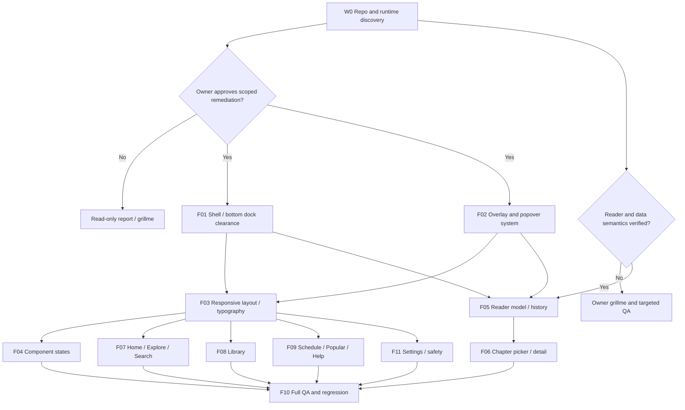

# Execution roadmap — component-first, page-verified

**Do not equate 'EXECUTE planning pack' with 'permission to edit application source'.** Owner requested the package now; code changes remain explicitly gated.

## Dependency graph

*Graph is proposed workflow, not implementation evidence.*

## Phase gates
### Gate 0: Discovery / no code changes
Deliver: repository inventory, source paths for shared shell/components, screenshot baseline, existing token/theme/navigation mapping, behavior trace and exact test environment. Update each selected issue's `code_location`, not guess.

### Gate 1: Root-cause / design acceptance
For each workstream, write 1-page fix proposal: current defect, root cause confidence, affected routes, candidate correction **without visual redesign**, test cases, rollback and impact. Owner approves behavioral changes and major visual rearrangement before coding.

### Gate 2: Implement one shared cause
Modify component-level shared rules first; follow with page-specific integration. Never patch 10 pages independently when one shared defect is responsible. If shared patch causes layout regressions, revert/adjust and document.

### Gate 3: QA at source and across pages
Capture before/after same viewport, state, scroll location, theme; test keyboard + touch + slow network where relevant; validate data/history explicitly. Set PASS only for executed checks.

### Gate 4: Owner acceptance and integration
Provide evidence, changed files, remaining unknowns, regression coverage and rollback. Do not deploy or modify DB/security without separate permission.

## Remediation waves
- **Wave A (foundation):** F01 and F02 after root-cause discovery. Highest leverage for many screens.
- **Wave B (reader truth):** F05 and F06. Behavior integrity before polishing reader appearance.
- **Wave C (structural density and controls):** F03 and F04. Preserve palette and existing identity.
- **Wave D (page task flows):** F07, F08, F09 and F11 — can be parallel only after shared contracts stabilized.
- **Wave E (release QA):** F10 on all touched routes with dark/light and accessibility.

## Anti-shortcut rules
- 'Fix complete' is never a mock screenshot, pixel tweak, unchecked typecheck, or untested claim.
- No broad UI rewrite because individual components are ugly. Preserve functioning interactions and design language.
- No backend/data migration from screenshot-only ambiguity. Reproduce and ask first.
- No redesign of logo, colors, navigation structure or user-facing features unless owner explicitly approves.
- No random 8/16/24 px value patches across files without a shared layout rule.
- Commit / PR boundaries should follow workstream, not screenshot order.

## Success criteria
- Functional task paths: open comic, resume last position, save title, pick chapter, change source, filter saved list, manage storage safely, open help; all verified.
- No essential content/control occlusion by dock, toast, popup across affected routes.
- No critical selected value unintelligibly truncated in tested supported viewports.
- Semantics and copy accurately match true app behavior.
- No new regression in theme, dense layout, keyboard, responsive and history/save behaviors.
